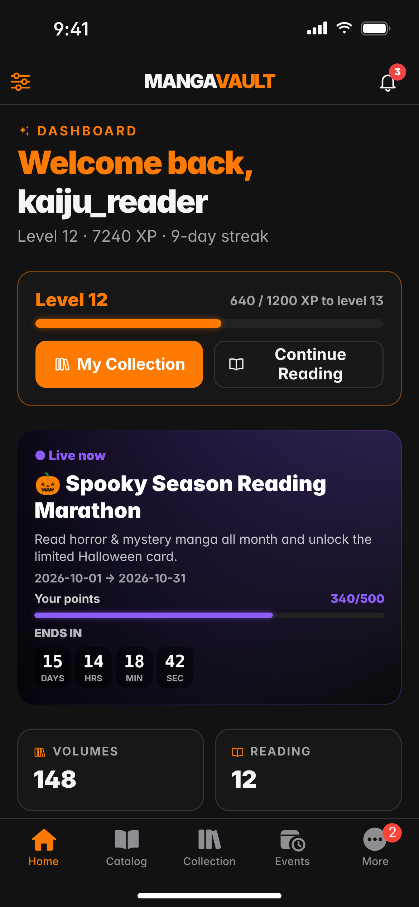
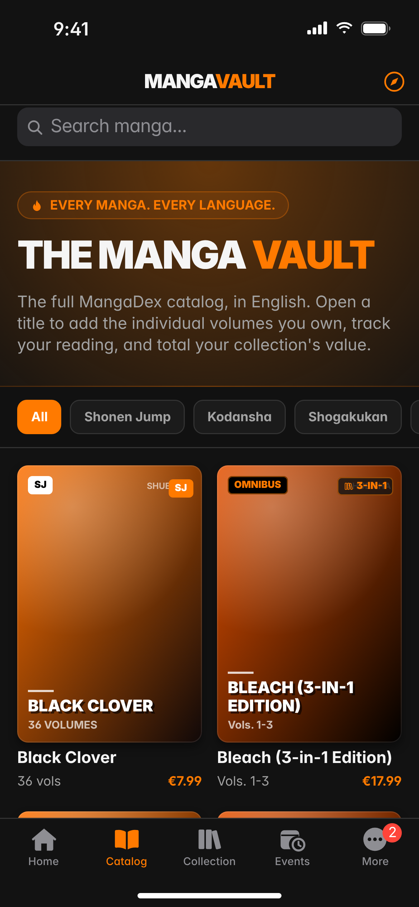
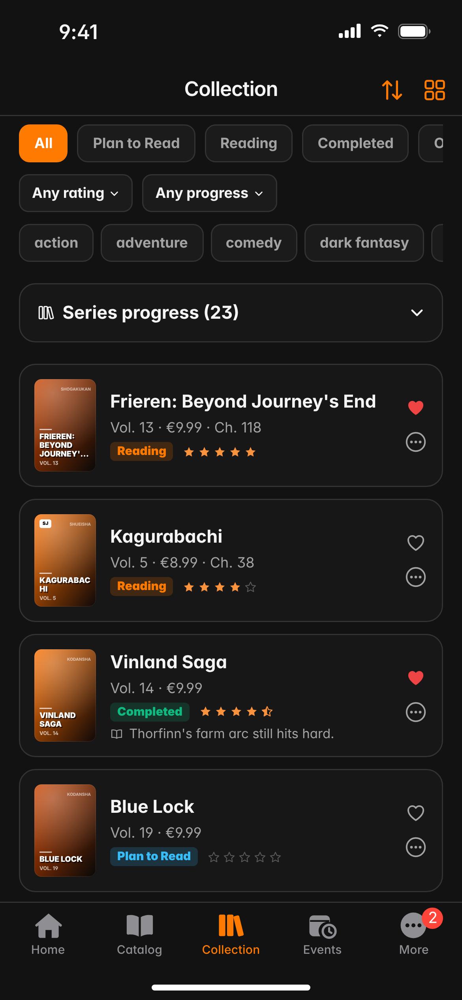
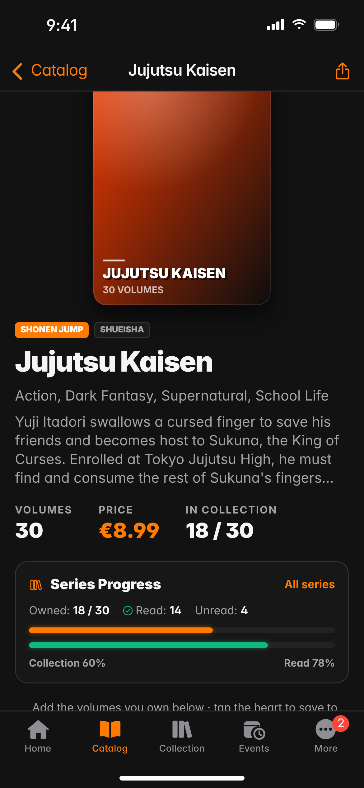
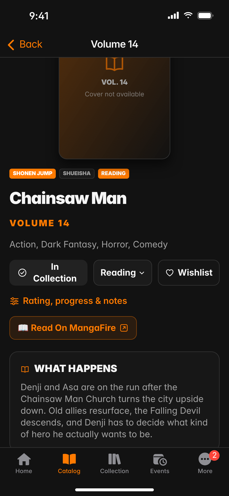
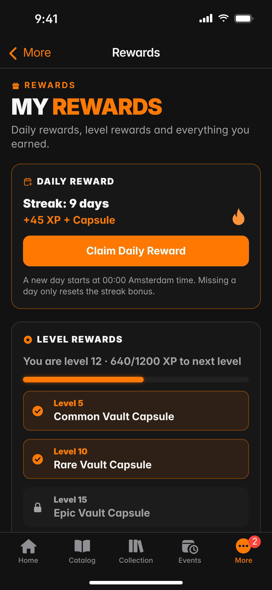
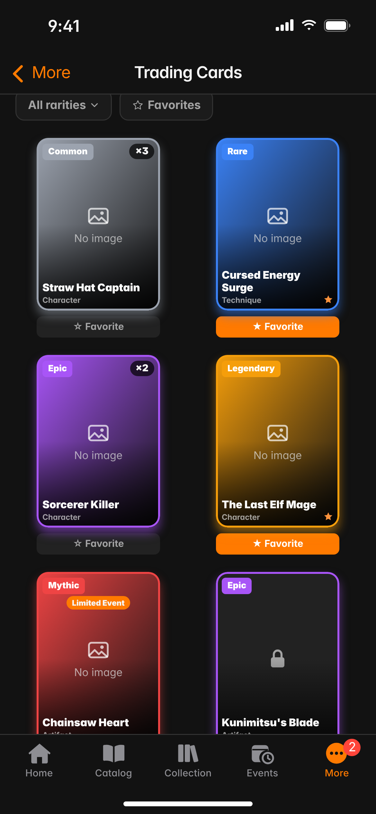
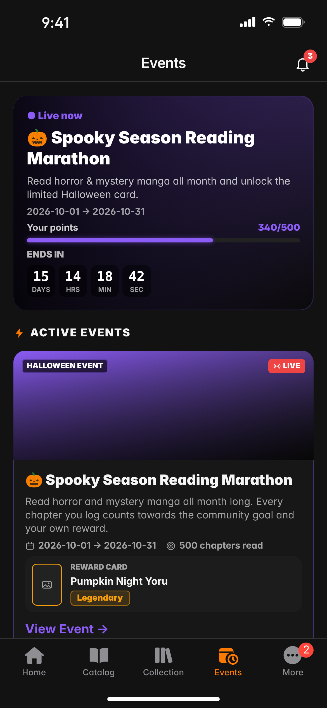
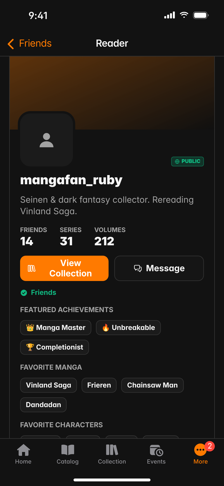
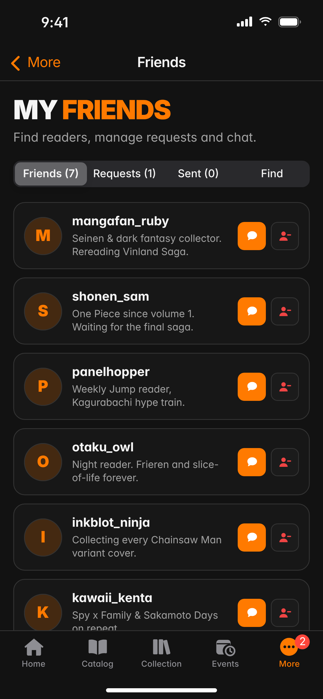

# Manga Vault

Manga Vault is je persoonlijke manga-kluis: houd per volume bij welke manga je hebt, wat je leest en wat je nog wilt kopen, en verdien XP, kaarten en beloningen terwijl je verzameling groeit.

De app hoort bij de website [mangas.base44.app](https://mangas.base44.app) en gebruikt hetzelfde account en dezelfde gegevens. Wat je op de website toevoegt, zie je direct in de app, en andersom.

Er is een native app voor **iPhone/iPad** (SwiftUI) en voor **Android** (Kotlin + Jetpack Compose).

  
  
  

## Wat kun je ermee?

### Catalogus en manga
De volledige MangaDex-catalogus in het Engels, met zoeken, filteren op uitgever en een "Surprise me"-knop. Op de pagina van een manga zie je alle volumes, je voortgang in de reeks, een samenvatting en de hoofdstukken. Per volume kun je het toevoegen aan je collectie of verlanglijst, en het direct openen op MangaFire.

  
  

### Collectie
Alles wat je bezit, met status (Plan to read, Reading, Completed, On hold, Dropped), beoordeling, hoofdstukvoortgang en notities. Sorteer op 11 manieren, filter op genre, beoordeling en voortgang, en zie per reeks hoe compleet je bent.

### Home
Je level en XP, een banner voor het actieve event, je statistieken en tellers voor kaarten, achievements en capsules. De onderdelen kun je zelf aan- en uitzetten en ordenen: verder lezen (met een **+1 hoofdstuk**-knop), dagelijkse quests, recente achievements, recente kaarten, laatst toegevoegd en grafieken.

### Beloningen
- **Rewards**: dagelijkse beloning met streak, levelbeloningen en een overzicht van alles wat je verdiend hebt.
- **Vault Capsules**: open verdiende capsules en zie wat erin zat.
- **Trading Cards**: je kaartencollectie met zeldzaamheid, favorieten en een gratis starterspakket.
- **Quests en achievements**: dagelijkse en wekelijkse quests en 16 achievements.

XP en levels worden op de server bijgehouden, dus de app en de website laten altijd hetzelfde zien.

  
  
  

### Events
Actieve, komende en afgelopen community-events met aftellen, quests, beloningen en ranglijsten, plus speciale events zoals het kerstevent en het Boruto Vol. 7-event.

### Sociaal
Vrienden zoeken en toevoegen, chatten, meldingen, openbare profielen, de collecties van vrienden bekijken en je eigen Manga Room inrichten.

  
  

### Bibliotheek en ontdekken
Verlanglijst, Series Tracker, leeskalender met leessessies, dagboek, tier lists, Manga Wrapped en statistieken. Om iets nieuws te vinden: aanbevelingen, Manga Roulette, een willekeurige manga en Manga Versus.

## Navigatie

Onderin vijf tabbladen: **Home · Catalog · Collection · Events · More**. Onder **More** staat de rest (verlanglijst, vrienden, berichten, rewards, capsules, kaarten en de bibliotheek). Het belletje rechtsboven toont je meldingen.

## Projectstructuur

| Map | Inhoud |
|---|---|
| `ios/` | Xcode-project (SwiftUI, iOS 17+, geen externe packages) |
| `android/` | Android Studio-project (Kotlin, Jetpack Compose, Android 8.0+) |
| `docs/screenshots/` | Afbeeldingen voor deze README |

## Zelf bouwen

**iOS**: open `ios/MangaVault.xcodeproj` in Xcode 16 of nieuwer en druk op Run.

**Android**: open de map `android/` in Android Studio en druk op Run, of bouw vanaf de commandoregel met `./gradlew assembleRelease`.

## Goed om te weten

- Beheerderstools (event-editor, kaartbeheer) staan alleen op de website.
- Chat en meldingen verversen in de app elke 30 seconden.
- Inloggen kan met e-mail en wachtwoord of met Google.
